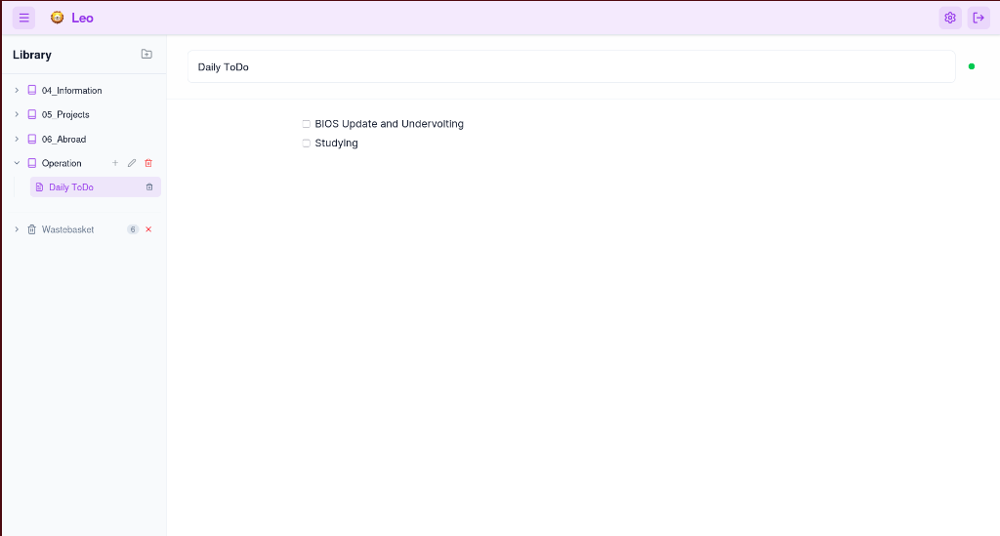
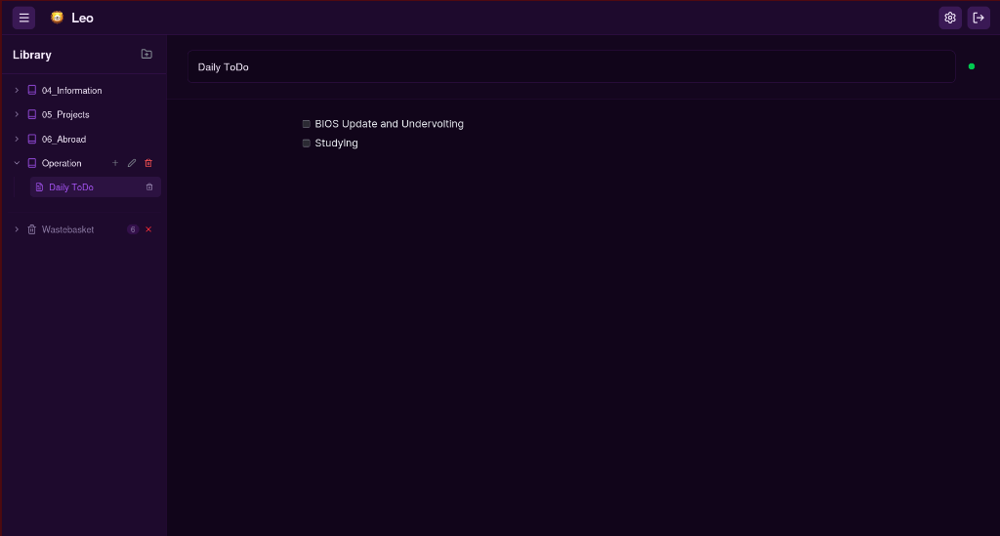
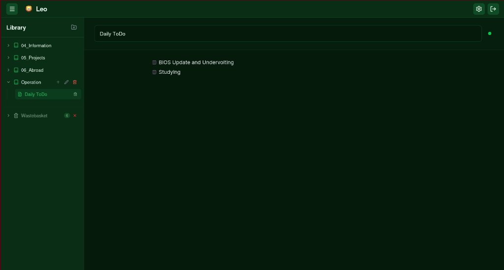
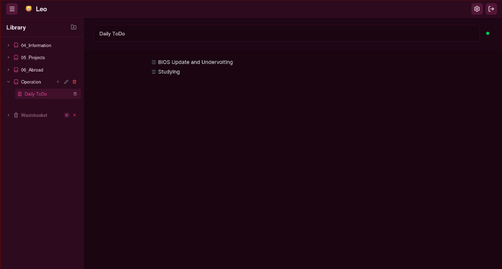

# Leo

A block-based note-taking app that runs in the browser, as an installable PWA, and as a Tauri desktop app, with notes synced through Firebase.

Live version: https://leo-notes.web.app (deployed to Firebase Hosting from `main` by GitHub Actions)

## Why I built it

I wanted a Notion-style editor for my own notes, organized in nested notebooks, that works the same on my laptop and my phone and keeps working when I'm offline.

## What it does

- Block editor (BlockNote) for notes: headings, lists, toggle lists and the rest of the default BlockNote blocks. I patched Enter and Backspace handling inside toggle lists so child blocks are not lost or outdented by accident.
- Notebooks can be nested. The sidebar shows them as a tree, and I can drag notes between notebooks or drag a notebook into another one. Dropping a notebook into one of its own descendants is blocked.
- Deleting is a soft delete. Deleted notes and notebooks go to a Trash view where they can be previewed read-only, restored or deleted for good.
- Edits are saved automatically with a 1.5 second debounce. A status indicator shows when the app is offline.
- Email/password sign-up, sign-in and password reset with Firebase Auth.
- Light and dark mode plus eight accent colors. The choice is stored in the user's Firestore profile, so it follows the account.
- Installable as a PWA. When a new build is deployed, the app shows an update prompt instead of silently serving the old cache. There is also a small recovery script in `main.tsx` that runs outside React to clear a broken cached service worker.

## How it works

- All data lives in Firestore under `users/{uid}/notebooks/{notebookId}/notes/{noteId}`. Note content is stored as BlockNote JSON.
- Firestore is initialized with persistent local cache (IndexedDB, multi-tab), so notes load and can be edited offline and sync when the connection comes back.
- Hooks in `src/hooks` wrap Firestore reads and writes in TanStack Query mutations. Lists are kept up to date with `onSnapshot` real-time listeners.
- Moving a note between notebooks copies it to the new subcollection and deletes the old one in a single batch write.
- `firestore.rules` denies everything by default, only lets a signed-in user read and write their own `users/{uid}` tree, and validates titles (string, max 200 chars) and allowed profile fields.
- UI state (selected note, expanded notebooks, theme) is in a Zustand store persisted to `localStorage`.
- The Tauri app loads the same Vite build. The Rust side is still the default Tauri template; there are no custom native commands yet.

## Tech stack

React 19, TypeScript, Vite, BlockNote, Mantine, Tailwind CSS 4, dnd-kit, Zustand, TanStack Query, Firebase (Auth, Firestore, Hosting), vite-plugin-pwa, Tauri 2.

## Screenshots

| | |
|---|---|
|  |  |
|  |  |

## Running it

Requirements: Node.js (CI uses Node 22) and, for the desktop build, Rust and the Tauri prerequisites.

1. Create a Firebase project with Email/Password auth and Firestore enabled, and register a web app.
2. Create a `.env` file in the project root. The app throws on startup if any of these are missing:

   ```env
   VITE_FIREBASE_API_KEY=
   VITE_FIREBASE_AUTH_DOMAIN=
   VITE_FIREBASE_PROJECT_ID=
   VITE_FIREBASE_STORAGE_BUCKET=
   VITE_FIREBASE_MESSAGING_SENDER_ID=
   VITE_FIREBASE_APP_ID=
   ```

3. Install and run:

   ```bash
   npm install
   npm run dev          # web, http://127.0.0.1:1420
   npm run tauri dev    # desktop window
   ```

4. Build:

   ```bash
   npm run build        # web build in dist/
   npm run tauri build  # desktop installers
   ```

To deploy the rules and hosting to your own project, change the project id in `.firebaserc` and run `npx firebase deploy`.

## Project structure

```
src/
  components/   auth, editor, layout (Sidebar, MainView), settings, ui
  hooks/        Firestore data hooks (notes, notebooks, auth, settings)
  stores/       Zustand UI store
  lib/          Firebase init and types
src-tauri/      Tauri desktop shell
firestore.rules Firestore security rules
```

## Limitations

- No search across notes yet.
- No file upload, so images can only be added by URL.
- Notes and notebooks are sorted alphabetically only.
- The desktop app is a plain wrapper around the web build.
- There are no automated tests.

## Credits

The delete button and bottom drawer are adapted from [Rare UI](https://rareui.com) by Swami Malode (MIT + Commons Clause + Attribution — see `src/components/ui/rareui/LICENSE`).

## License

MIT
